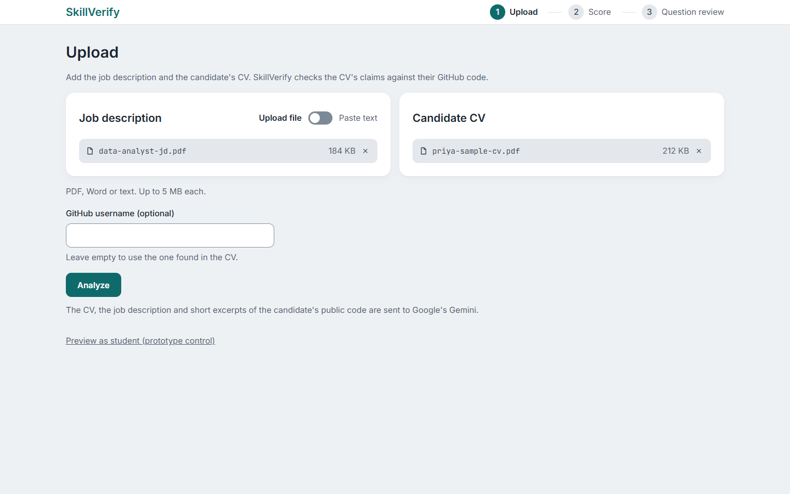
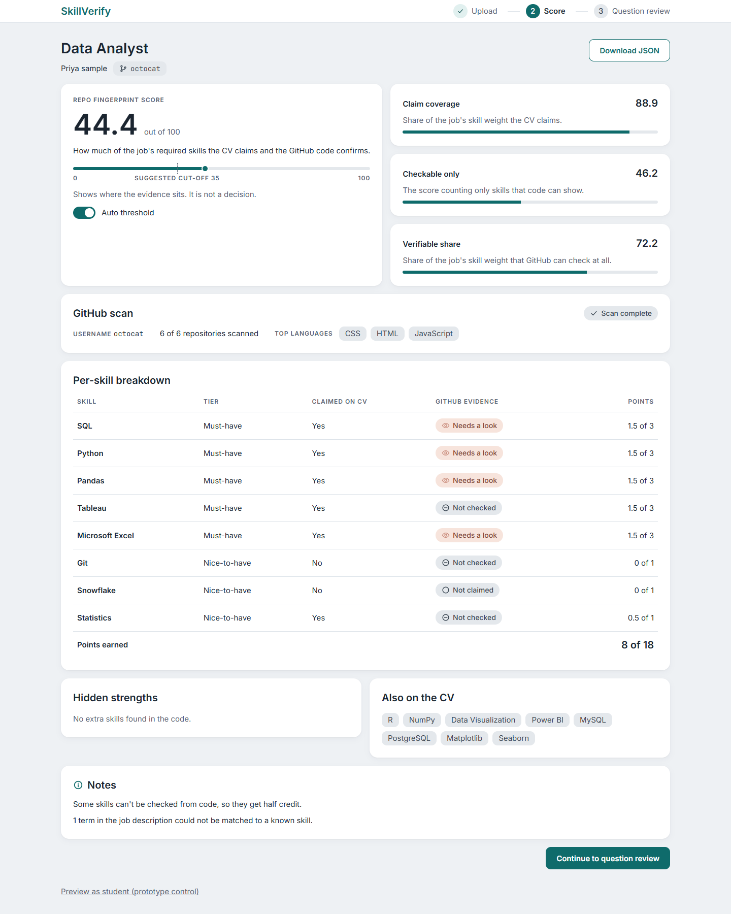
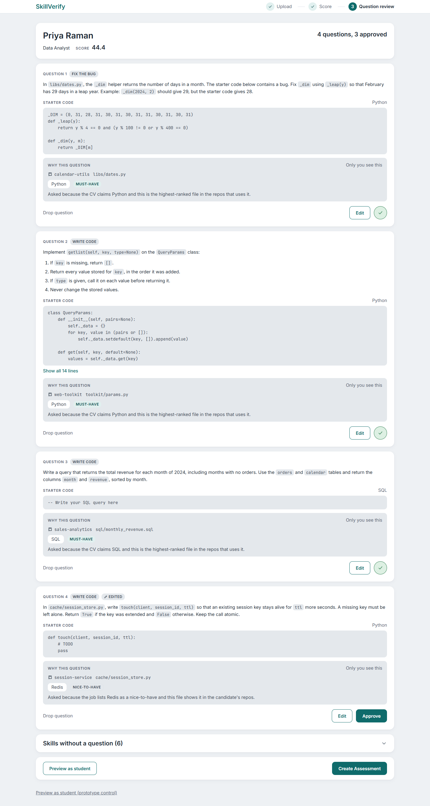

# SkillVerify

SkillVerify is an AI-assisted technical interview navigator. It cross-checks the skills a candidate **claims** on a CV
against the **real work** in their public GitHub repositories, scores how well the two agree for one job description,
and then drafts interview questions grounded in the candidate's own code, for a human recruiter to review.

> **Work in progress.** This is a student project under active development. Phase 1 (the evidence and scoring
> pipeline) is complete. In Phase 2 the question generator and the recruiter review flow are built, but the student
> screen, the code sandbox and AI grading are **not built yet**. Expect rough edges; see [Status](#status) and
> [Known limits](#known-limits).

SkillVerify produces **evidence for a human, never a hiring verdict**: there is no pass/fail, no threshold and no
"recommended" label anywhere. A CV claim is not proof, and a missing GitHub signal is not proof of absence.

## Status

| Part | State |
|---|---|
| Phase 1: GitHub Validator, tech-stack scanner, skill taxonomy, JD Parser, CV Parser, Repo Fingerprint Score | **Complete** |
| Phase 2: question generator (backend) and the FastAPI service | **Built** |
| Phase 2: recruiter web app (Upload, Score, Question review) | **Built** |
| Student screen (answering the questions, timer) | Not built. Only a design placeholder exists |
| Code sandbox (running the student's code) | Not built |
| AI grading of answers | Not built |
| Accounts, a database, deployment | Not built. Jobs live in memory and are lost on restart |

## The Phase 1 pipeline

```
 job description ──► JD Parser ──────────┐
                                         ├──► Repo Fingerprint Score ──► score + evidence trail
 CV (PDF/DOCX/TXT) ► CV Parser ──────────┤
                                         │
 GitHub username ──► GitHub Validator ───┤
                     └► Tech-stack scanner
 (all skill names are normalised by the shared Skill Taxonomy)
```

1. **GitHub Validator** (`skillverify/github_validator.py`): for a username, returns structured evidence: languages,
   commit ownership (commits matched to the candidate's own login), recency, and which repos count (forks are listed
   but not counted).
2. **Skill Taxonomy** (`skillverify/taxonomy.py`, `data/skills.json`): one shared list of canonical skill names
   (165 base skills plus a few extras) so "JS", "Javascript" and "ES6" are the same skill everywhere.
3. **Tech-stack scanner** (`skillverify/tech_scanner.py`, with a strict SQL detector in `sql_strict.py`): reads
   dependency files, imports and embedded SQL in the candidate's repos to find libraries and tools that GitHub does
   not report as "languages".
4. **JD Parser** (`skillverify/jd/`): uses Google Gemini to turn a job description into a tiered, taxonomy-mapped
   skill list (must-have or nice-to-have). Code checks the model's answer against the text, so invented skills are
   rejected.
5. **CV Parser** (`skillverify/cv/`): extracts text from PDF, Word or plain text; finds and redacts contacts with
   code before the model sees anything; then uses Gemini to list claimed skills, projects and education, again
   verified against the CV text.
6. **Repo Fingerprint Score** (`skillverify/scoring/`): a pure, offline calculation (no model, no network). Each job
   skill has a weight (must-have 3, nice-to-have 1) and a credit (1.0 claimed and confirmed on GitHub, 0.5 claimed but
   not confirmed, 0 not claimed). The score is `sum(weight × credit) / sum(weight) × 100`. Flags, "hidden strengths"
   and the other figures sit beside the score and never change it. The formula is documented in
   [docs/SCORING.md](docs/SCORING.md).

## Phase 2: questions and the recruiter flow

- **Question generator** (`skillverify_questions/`): code, not the model, chooses which files to ask about (it filters
  out vendored, generated, test and tiny files, then ranks the rest per job skill). Gemini only writes one question
  per chosen file. Plain code then checks every question against the real file (real names, no invented tables,
  fix-the-bug questions need a concrete failing example, no secrets or URLs). A failed question gets one repair
  attempt and is then dropped, with a reason code. Fewer than 3 questions is reported honestly, never padded.
  Details: [docs/QUESTIONS.md](docs/QUESTIONS.md).
- **API** (`api/`): a FastAPI service that runs the pipeline as background jobs, with a model fallback chain for
  Gemini rate limits, time limits and a cap on how many repositories one analysis reads. Routes and error codes:
  [docs/API.md](docs/API.md).
- **Web app** (`web/`): React + TypeScript + Vite. Upload a job description and CV, read the score and its evidence,
  then review the generated questions: edit, approve, drop, ask for a replacement, preview what a student would see.

### Screenshots

All screenshots use fictional sample data.

| Upload | Score | Question review |
|---|---|---|
| [](docs/screenshots/upload.png) | [](docs/screenshots/score.png) | [](docs/screenshots/question-review.png) |

## Setup

You need **Python 3.10+** (developed on 3.11) and, for the web app, **Node.js 20+**.

```bash
# 1. Python dependencies
pip install -r requirements.txt -r requirements-cv.txt -r requirements-api.txt

# 2. Keys: copy the template, then fill in your own values
cp .env.example .env        # Windows: copy .env.example .env
```

`.env` needs:

- `GITHUB_TOKEN`: a GitHub personal access token. A fine-grained token with **no extra permissions** (public data
  only) is enough. Without a token GitHub allows only about 60 requests per hour.
- `GEMINI_API_KEY`: a Google Gemini API key (used by the JD Parser, CV Parser and question generator).
- Optional: `GITHUB_TOKEN_BACKUP`, and `GEMINI_MODEL_CHAIN` (comma-separated model names, tried in order when one
  is rate limited). Model names change over time, so check which ones your key can use.

**Never commit `.env`.** It is git-ignored; only `.env.example` (placeholders) is tracked.

## Run it

**The web app and API together** (two terminals, from the project root):

```bash
# Terminal 1: the API on http://localhost:8000
uvicorn api.app:app --port 8000

# Terminal 2: the web app on http://localhost:5173
cd web
npm install
npm run dev
```

The web app talks to `http://localhost:8000` by default; change it with `VITE_API_URL` (see `web/.env.example`).
The API only allows requests from `localhost:5173`.

**The Phase 1 pieces from the command line** (each saves JSON under `output/`, which is git-ignored):

```bash
python examples/run_validator.py <github-username>
python examples/run_jd_parse.py --file examples/sample_jds/data_analyst.txt
python examples/run_cv_parse.py --file examples/sample_cvs/cv_data_analyst.txt
python examples/run_tech_scan_ext.py <github-username>
python examples/run_score.py --jd output/<job>_jdparsed.json --cv output/<cv>_cvparsed.json --github output/<user>_techstack_ext.json
```

See the docs for each step's options and output format.

## Tests

```bash
python -m pytest            # Python: all HTTP and Gemini calls are faked; nothing real is contacted
cd web && npm test          # web app (Vitest, fetch is mocked)
```

Please note: a few Phase 1 tests check that a local review-queue file under `output/` was never created, so they fail
if you have run the example scripts with auto-add enabled and left that file in `output/`. Delete it and they pass.

## Documentation

| File | Topic |
|---|---|
| [docs/TAXONOMY.md](docs/TAXONOMY.md) | the skill taxonomy |
| [docs/TECH_SCANNER.md](docs/TECH_SCANNER.md), [docs/EXTENSIONS.md](docs/EXTENSIONS.md) | the tech-stack scanner, extra skills, strict SQL |
| [docs/JD_PARSER.md](docs/JD_PARSER.md), [docs/CV_PARSER.md](docs/CV_PARSER.md) | the two parsers |
| [docs/SCORING.md](docs/SCORING.md) | the Repo Fingerprint Score |
| [docs/QUESTIONS.md](docs/QUESTIONS.md) | the question generator |
| [docs/API.md](docs/API.md) | the HTTP API, errors, limits |

## Privacy

SkillVerify handles personal data, so please read this before using it with real candidates.

- The CV text (with emails and phone numbers replaced), the job description, and short excerpts of the candidate's
  **public** code are sent to Google's Gemini. Secrets found in code are redacted before sending. Only use CVs and job
  descriptions you are allowed to process, and check the terms of your Gemini plan.
- Saved output (`output/`) contains personal data and is git-ignored. Uploaded files are kept in memory only.
- All sample CVs in this repository are fictional (`example.com` addresses, invented people and institutions).

## Known limits

- **Work in progress:** the student screen, sandbox and AI grading do not exist yet, so a recruiter can review and
  approve questions but cannot yet run a real assessment.
- **No persistence or accounts:** jobs and generated questions live in memory (at most 20 jobs for an hour) and are
  lost when the server restarts. There is no login and no multi-user support. Do not expose the API to the internet.
- **Only public GitHub data** is read. A skill with no public code, or one GitHub cannot show (for example Tableau),
  is reported as "can't be checked", not as "absent".
- **Large accounts are capped:** only the newest 30 non-fork repositories (configurable) are inspected, and the
  response says so.
- **Question quality is still being tuned.** It depends on the candidate's code and on a language model; the checks
  catch many invented details but not all. A recruiter must review every question.
- **Tested with fakes, lightly with live data.** The automated tests never call Gemini or GitHub. Live testing so far
  has been small-scale.
- **No licence has been chosen yet.**
